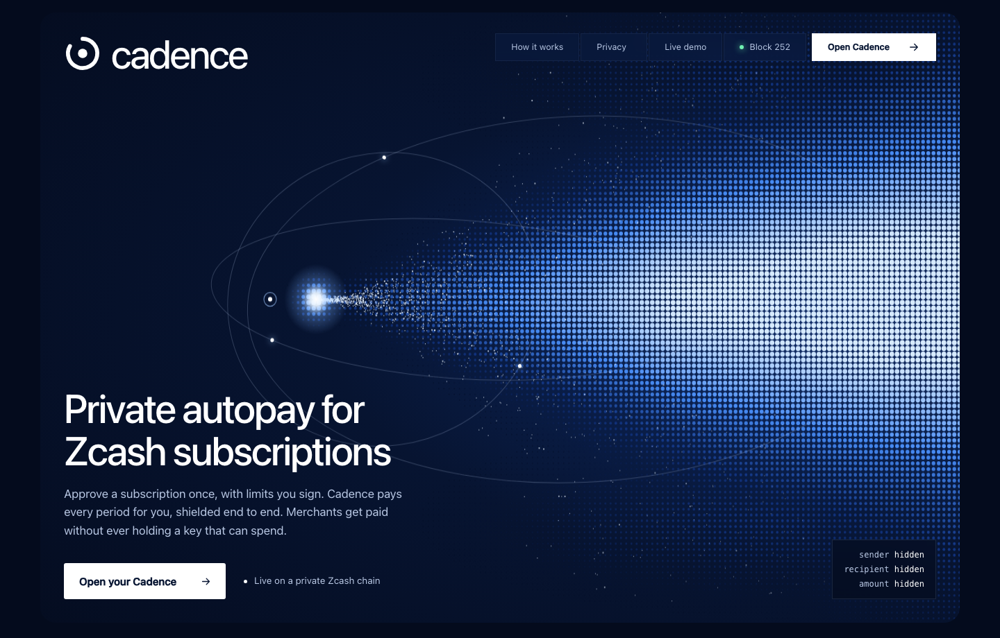
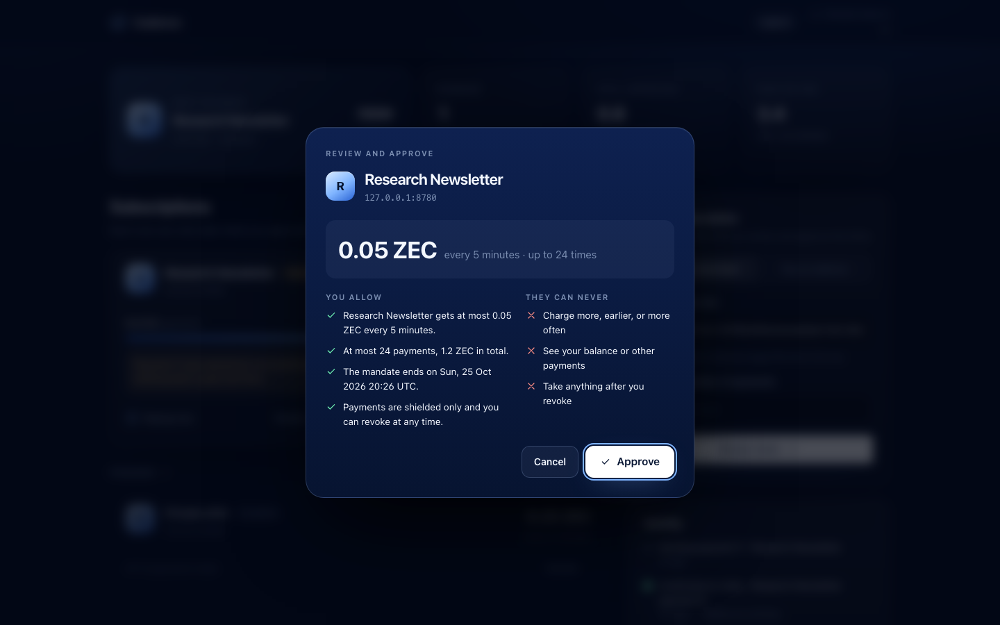
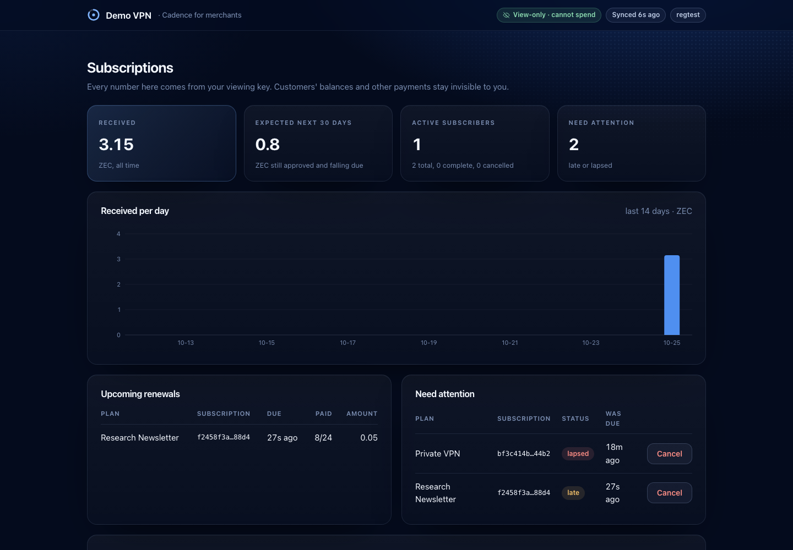
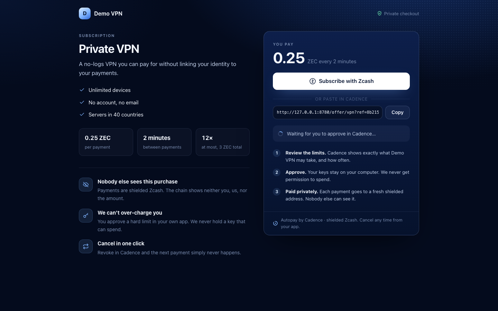

# Cadence

**Private autopay for Zcash subscriptions.**

Zcash can't pull money from a wallet, so every subscription today means remembering to pay.
Cadence lets a subscriber approve a subscription once, with hard limits they sign, and then pays
each period automatically, shielded end to end. The merchant gets paid without ever holding a key
that can spend.

Built for **ZECATHON 2026 · Shielded Payments**.



---

## The problem

Recurring payments are most of real commerce: VPNs, hosting, newsletters, rent, donations,
payroll. On transparent chains they leak a person's whole financial life. On Zcash they are
private, but there is no way to charge a customer each month, so merchants fall back to
reminders and manual payment requests, and subscribers miss payments.

## What Cadence does

| | |
|---|---|
| **Subscriber** | Approves a *mandate*: payee, exact amount, period, number of payments, end date. A local agent pays each period and refuses anything outside the mandate. Revoke stops it immediately. |
| **Merchant** | Publishes plans and a checkout page. Issues a signed invoice with a **fresh shielded address** each cycle, and sees payments through a **viewing key only**. It cannot spend. |
| **Anyone else** | Sees a shielded transaction and a fee. Not who paid, not who was paid, not how much. |

Two ways to pay:

- **Merchant mode.** The mandate binds the merchant's signing key. Each cycle the merchant signs an
  invoice with a new address; the agent checks the signature, the amount, the schedule and the
  address before paying.
- **Address mode.** Autopay to any shielded address, with nothing needed from the payee: rent,
  donations, a friend. Paying the same shielded address every cycle is not visible on chain.



## Privacy, checked rather than claimed

Every payment is read back from the chain by `cadence agent proof`, which checks it the way an
outside observer would, and runs the same checks on a known-leaky control transaction that must
fail. On our test runs:

| Check | Result |
|---|---|
| Transparent inputs or outputs | **0** in every payment |
| Value entering or leaving the shielded pool | only the fee |
| Payment amount anywhere in public data | nowhere |
| Address reuse across merchant cycles | none |
| All payments look alike on chain | same version, pool, action count and fee |
| Control (transparent coinbase) | caught on 4 checks |

What the agent enforces before every send:

- shielded-to-shielded only; it refuses transparent recipients and never spends transparent funds
- exact amount, due time, grace period, cycle count, total cap and end date from the signed mandate
- merchant invoices must be signed by the key in the mandate; addresses can't repeat
- a random send time inside a window, so renewals don't land on a fixed second
- write-ahead record before each send, confirmation tracking after it, and recovery from the
  wallet's own records after a crash, so a cycle is never paid twice

What it does **not** hide, stated plainly:

- The light-wallet server sees the IP that syncs and broadcasts. Set `"connection": "tor"` to route
  through Tor.
- Block heights are public. A payee who knows the schedule can expect a payment.
- The payee knows the amount and that the same subscriber renewed. That is the point of a
  subscription, and nobody else learns it.

## Merchant side



The merchant server is built from a **unified full viewing key** (`zcash-devtool wallet init-fvk`):
it derives a new receive address per cycle and reads payments, but holds no spending key. A breach
of the merchant server cannot move funds. It provides plans, a checkout page, signed invoices, a
dashboard (revenue, renewals, late and lapsed subscribers), and signed webhooks.



## Try it

Requirements: Node.js 24, Rust (rustup), git, a C toolchain.

```sh
sh scripts/build-local-chain.sh   # once: builds Zebra, Zaino and zcash-devtool (pinned versions)
npm run demo                      # private Zcash chain + merchant + your Cadence app, then open the printed link
```

`npm run demo` creates a private regtest chain with the same network upgrades as mainnet today
(through NU6.3 Ironwood, no NU7), mines test coins straight into the subscriber's **shielded**
address, starts the merchant and the subscriber app, mines blocks whenever a payment needs confirming, and serves a
page that links every part. The demo plans renew every few minutes so you can watch full cycles.

Verify the privacy of every payment the demo made:

```sh
node src/cli.ts agent proof --config ~/.cadence-demo/agent/agent.json --rpc http://127.0.0.1:18232
```

Tests (no network, no chain needed):

```sh
npm test
```

### Command line

```
cadence agent app       --config agent.json          local app: subscriptions, approvals, revoke
cadence agent subscribe --config agent.json --offer <merchant>/offer/<plan>
cadence agent subscribe --config agent.json --address <shielded address> --amount 0.5 --every-days 30 --cycles 12
cadence agent run | status | revoke | log --verify | proof
cadence merchant serve  --config merchant.json
```

### Run it on a server

`scripts/server-setup.sh <public-ip>` sets up a fresh Ubuntu 24.04 machine: Node and Rust from
verified official releases, the Zcash tools, HTTPS through Caddy, and a systemd service that starts
on boot and restarts on failure.

## How it is built

```
 subscriber machine                                   merchant server (viewing key only)
 ┌──────────────────────────────┐                     ┌──────────────────────────────┐
 │ Cadence app (127.0.0.1)      │   offer, invoices   │ plans · checkout · invoices  │
 │  mandate store · policy      │◄───────────────────►│ per-cycle addresses          │
 │  scheduler · audit log       │                     │ payment matching · webhooks  │
 │  zcash-devtool wallet        │                     │ zcash-devtool view-only      │
 └──────────────┬───────────────┘                     └──────────────┬───────────────┘
                │   shielded payment (Orchard/Ironwood)               │ reads with viewing key
                ▼                                                     ▼
          ┌──────────────────── Zcash (Zebra + Zaino / lightwalletd) ──────────────────┐
```

| Path | What |
|---|---|
| `src/mandate.ts`, `src/policy.ts` | the mandate and every rule checked before a payment |
| `src/agent.ts` | scheduling, write-ahead sends, confirmation tracking, crash recovery, revoke |
| `src/invoice.ts` | Ed25519-signed per-cycle invoices |
| `src/merchant.ts`, `src/server.ts`, `src/checkout.ts` | merchant service, checkout, dashboard API |
| `src/devtool.ts`, `src/scan.ts` | wallet adapter over zcash-devtool; reading payments from a viewing-key wallet |
| `src/proof.ts` | the on-chain privacy proof |
| `src/app.ts` | the subscriber's local app (token, Host and Origin checks; nothing listens beyond 127.0.0.1) |
| `src/demo.ts`, `src/hub.ts` | the one-command demo and its landing page |

No runtime dependencies beyond Node's standard library. Wallet work goes through
[zcash-devtool](https://github.com/zcash/zcash-devtool) on librustzcash.

## Status and limits

- Runs end to end on a private regtest chain with real shielded transactions and real proofs.
- Public testnet: wallets and the send path are set up, but the public faucets are paused while
  testnet moves to NU7, so no public testnet payment has been made yet.
- The subscriber agent holds the subscriber's spending key and is meant to run on their own
  device. Running it on a hosted machine means trusting that host.
- Not audited. Use with test funds.

## License

MIT
